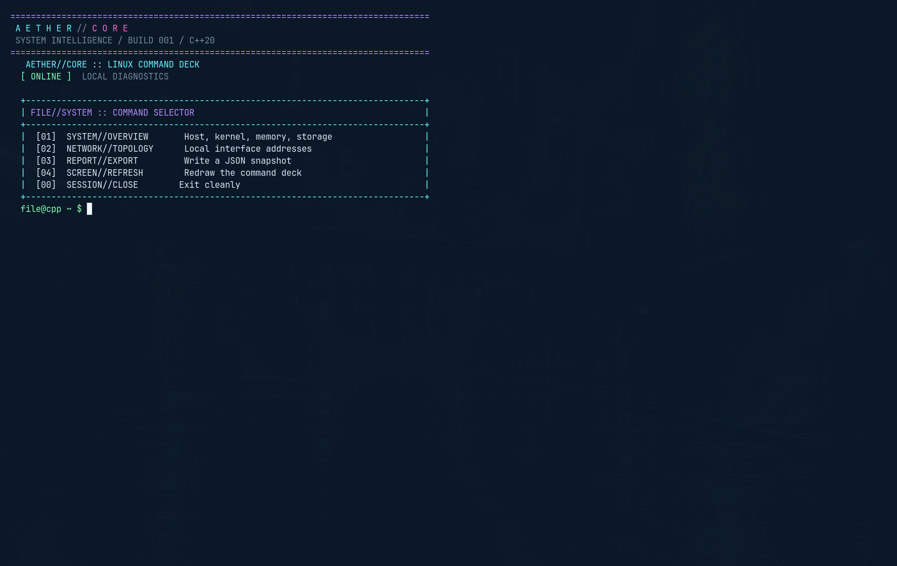

# AETHER//CORE

**A futuristic Linux system diagnostics command deck built with C++20.**

AETHER//CORE is a terminal-native system inspection CLI designed for Omarchy, Hyprland, and other Linux environments. It combines practical Linux diagnostics with a custom neon command interface.



## Features

- Hostname, kernel, architecture, uptime, and CPU core count
- Memory availability and root filesystem free space
- Local IPv4 and IPv6 interface addresses
- JSON report export
- Custom ANSI color palette with `NO_COLOR` support
- CMake build system and CTest integration
- GitHub Actions build-and-test workflow
- Graceful Ctrl+C handling and error messages on stderr

## Requirements

- Linux
- C++20-compatible compiler, such as GCC or Clang
- CMake 3.20 or newer
- Standard Linux development tools

## Build

```bash
cmake -S . -B build -DCMAKE_BUILD_TYPE=Release
cmake --build build --parallel
```

## Install

Install the `AetherCore` command into `~/.local/bin` (already on `PATH` on most systems):

```bash
cmake --install build
```

If `~/.local/bin` is not on your `PATH`, add it:

```bash
export PATH="$HOME/.local/bin:$PATH"
```

## Run

Once installed, run the command deck from anywhere:

```bash
AetherCore
```

You can also run the build copy directly:

```bash
./build/AetherCore
```

## Run tests

```bash
ctest --test-dir build --output-on-failure
```

## Exported reports

Choose `03` in the command menu. Reports are written to `~/aether-reports/` when `HOME` is available, or to an `aether-reports` directory under the current working directory.

## Terminal colors

AETHER//CORE uses ANSI true-color escape sequences when standard output is a terminal. Set `NO_COLOR=1` to disable color output:

```bash
NO_COLOR=1 AetherCore
```

## Safety and privacy

The application reads local system information and network interface addresses. It does not change system configuration, execute arbitrary shell commands, or perform remote network scans. Review exported reports before sharing them, because they may contain your hostname and local IP addresses.

## Project structure

```text
aether-core/
├── main.cpp
├── include/aether/
│   ├── terminal_ui.hpp
│   ├── system_info.hpp
│   ├── network.hpp
│   └── reports.hpp
├── src/
│   ├── terminal_ui.cpp
│   ├── system_info.cpp
│   ├── network.cpp
│   └── reports.cpp
├── tests/test_main.cpp
├── .github/workflows/ci.yml
├── CMakeLists.txt
├── README.md
├── LICENSE
└── .gitignore
```

## License

MIT License. See `LICENSE`.
